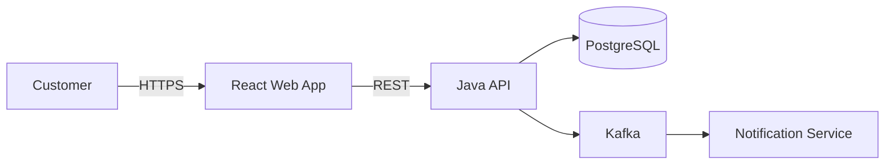

# 03. 高层设计：上下文图、容器图、组件图与部署图

## 学习目标

1. 使用不同层级的图表达架构，而不是把所有内容塞入一张图。
2. 理解 C4 Model 中 Context、Container、Component 的职责。
3. 使用 Deployment Diagram 说明运行时拓扑和可靠性设计。
4. 让图能够支持决策、沟通和维护。

## 一、架构图的目的

架构图不是装饰品。每张图都应该回答一个明确问题：

- 系统与谁交互？
- 系统由哪些可部署单元组成？
- 某个单元内部如何分解？
- 软件实际部署在哪里？
- 数据和请求如何流动？

一张图如果同时包含业务角色、Class、AWS Subnet、Kafka Topic 和每个 API method，通常没有人能读懂。

正确方法是通过多个 View 表达不同 Concern。

## 二、C4 Model 概览

C4 常见层级：

```text
Level 1: System Context
Level 2: Container
Level 3: Component
Level 4: Code（通常由代码或 IDE 表达）
```

这里的 Container 不是专指 Docker Container，而是一个可运行或可部署单元，例如 React SPA、Java Application、Database、Mobile App。

## 三、System Context Diagram

Context Diagram 展示目标系统、用户角色和外部系统。

它回答：

- 系统边界在哪里？
- 谁使用它？
- 它依赖哪些外部系统？
- 主要交互是什么？

示例：

```text
[Customer]
    |
    | places order
    v
[E-commerce Platform] ---- authorizes payment ----> [Payment Provider]
          |
          +---- obtains product data -------------> [ERP]
          +---- sends notifications --------------> [Email Provider]
```

Context Diagram 不应该出现 Java Class、Database Table 或 Pod。它面向 Product、Business 和 Technical Stakeholder。

## 四、Container Diagram

Container Diagram 展示系统内部主要可部署单元、技术选择和通信方式。

```text
[React Web App]
      | HTTPS/JSON
      v
[API Gateway]
      |
      +----> [Order Service / Java]
      |              |
      |              +----> [PostgreSQL]
      |              +----> [Kafka]
      |
      +----> [Catalog Service / Java]
                     |
                     +----> [OpenSearch]
```

每个 Container 应标注：

- 名称。
- 主要职责。
- 关键 Technology。
- 通信 Protocol。
- 重要数据存储。

Container Diagram 是系统设计面试中最常用的主图。

## 五、Component Diagram

Component Diagram 放大一个 Container，展示其内部主要组件。

以 Order Service 为例：

```text
[Order REST Controller]
          |
          v
[Create Order Use Case]
      |           |
      v           v
[Order Domain] [Payment Port]
      |
      v
[Order Repository Port]
      ^
      |
[JPA Adapter] ---> [PostgreSQL]
```

Component Diagram 适合解释：

- Layered/Hexagonal Architecture。
- Domain Boundary。
- Dependency Direction。
- 核心 Use Case 的协作关系。

没有必要为每个 Microservice 都画 Component Diagram。只展开最关键或最复杂部分。

## 六、Deployment Diagram

Deployment Diagram 展示软件实例如何部署到 Infrastructure。

```text
AWS Region
├── Availability Zone A
│   ├── Public Subnet: ALB node
│   └── Private Subnet: EKS worker / Order Pod
├── Availability Zone B
│   ├── Public Subnet: ALB node
│   └── Private Subnet: EKS worker / Order Pod
├── Multi-AZ RDS PostgreSQL
├── MSK Cluster
└── CloudWatch / OpenTelemetry Collector
```

它回答：

- 部署在哪个 Region/AZ？
- 如何实现 High Availability？
- Network Boundary 是什么？
- 数据如何复制？
- 哪些组件可水平扩容？
- 故障会影响哪些节点？

Deployment Diagram 应区分 Logical Component 与 Runtime Instance。例如 `Order Service` 是一个逻辑 Container，生产环境可能运行 20 个 Pod。

## 七、Dynamic Diagram 与 Sequence Diagram

静态图不能完整说明关键流程。对于 Checkout、Login 或 Event Processing，可以增加 Sequence Diagram：

```text
Customer -> Web App: Submit order
Web App -> Order API: POST /orders
Order API -> Inventory: Reserve items
Order API -> Payment: Authorize
Order API -> Database: Commit order + outbox
Order API --> Web App: Order accepted
Outbox -> Kafka: OrderCreated
Kafka -> Fulfillment: Start fulfillment
```

Sequence Diagram 特别适合展示：

- 同步与异步边界。
- Transaction Boundary。
- Retry、Timeout 和 Compensation。
- 数据一致性窗口。
- Critical Path Latency。

## 八、数据流与 Trust Boundary

处理 Security 和 Compliance 时，可以在图中标注：

- PII、Payment Data 等敏感数据流。
- Encryption in transit / at rest。
- Public、Private、Restricted Network Zone。
- Authentication 与 Authorization 点。
- External Trust Boundary。
- Audit Log 流向。

不要只画“组件连接”，还要说明连接承载什么数据以及安全语义。

## 九、画图规则

一张好图通常具备：

1. 明确标题和 Scope。
2. 图例（Legend）。
3. 一致的 Shape 和 Color 语义。
4. 箭头具有方向和标签。
5. System Boundary 清晰。
6. 每个元素有名称与职责。
7. 适合目标 Audience 的抽象层级。
8. 包含 Version 或 Last Updated 信息。

颜色不应是唯一信息载体，因为打印、色觉差异和不同主题可能导致信息丢失。

## 十、Diagram as Code

可以使用 Mermaid、PlantUML、Structurizr 或其他工具把图与代码一起管理。

Mermaid 示例：



Diagram as Code 的优势：

- 可以 Version Control。
- 容易 Review 差异。
- 可以在 CI 中生成。
- 文档更接近代码。

但对于探索阶段，白板仍然更快。工具应服务沟通，不应成为负担。

## 十一、面试中的画图顺序

1. 先画 Client、System Boundary 和 External Dependency。
2. 画核心 Container 与 Data Store。
3. 标记同步/异步通信和 Protocol。
4. 沿关键 Use Case 讲解数据流。
5. 放大一个关键 Component。
6. 补充 Cache、Queue、Scaling、Security 和 Observability。
7. 最后讨论 Deployment、Failure Mode 和演进方案。

边画边讲，不要沉默画十分钟后再解释。

## 十二、常见错误

- 一张图包含所有细节。
- 箭头没有方向或含义。
- 把 Kafka、Database 画出来，却不解释职责。
- 逻辑架构和物理部署混在一起。
- 图中没有 System Boundary。
- 只展示 Happy Path，不展示失败和异步流程。
- 图与实际系统长期不同步。

## 十三、自测题

1. Context Diagram 和 Container Diagram 分别面向什么问题？
2. C4 中的 Container 为什么不等于 Docker Container？
3. 什么情况下需要 Component Diagram？
4. Deployment Diagram 如何表达 AZ Failure 的影响？
5. Sequence Diagram 能发现哪些静态图不容易发现的问题？

## 十四、总结

- 架构需要多个 View，而不是一张万能图。
- Context 展示边界，Container 展示可部署单元，Component 展示内部结构。
- Deployment Diagram 展示运行时拓扑、网络和故障域。
- Sequence Diagram 说明关键流程、时序和失败处理。
- 图的价值在于支持共同理解和决策，必须保持简洁、准确和可维护。
